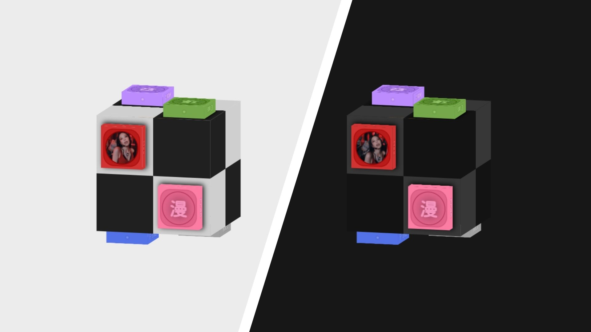

||
|:-:|
| <h1>嚴肅自我介紹  </h1> |

 

<table>
  <tr>
    <td width="50%">
      

        
      

    </td>
    <td width="50%">
      <h1>關於偶 — <a href = "https://hxx.lol">hxx.lol🦄</a></h1>
      
哈摟，我是Hxx。

      
主要用的程式語言是C， 偶爾也會用JavaScript來點綴醜醜的網頁。

    </td>
  </tr>
</table>

 

---

 

||
|:-:|
|<h1>我的主要專案</h1>|

 
  
<table>
  <tr>
    <td width="50%">
      

        
      

    </td>
    <td width="50%">
      <h1><a href = "https://github.com/calledhxx/hxx.lol">Hxx.lol</a> — 我的Weblog</h1>
      
這是我在夢中想出來的網站， 覺得很有趣，所以就在現實中做出來了。

      
就當作是一個花俏的作品吧， 之後我應該會做真正的Weblog出來。

    </td>
  </tr>
</table>
  

